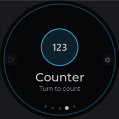
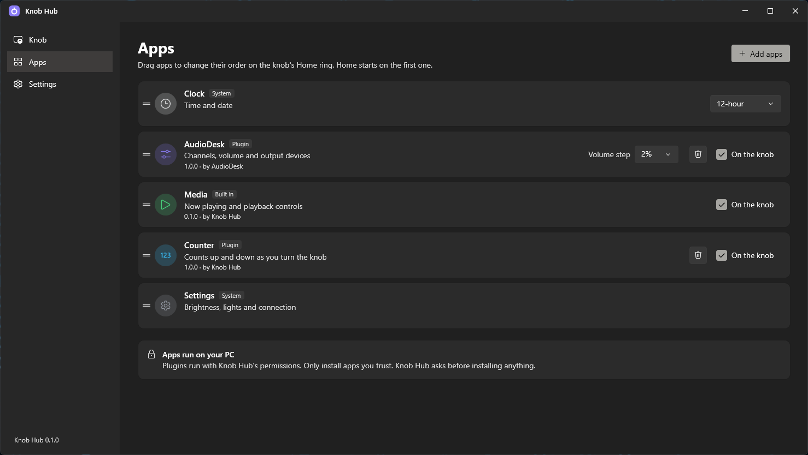
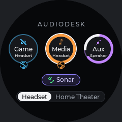
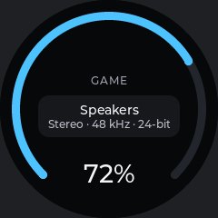
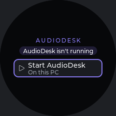

<h1 align="center">Knob Hub apps</h1>

  Apps for <a href="https://github.com/Shyam-Sangeeth/KnobHub">Knob Hub</a>, the round-screen knob controller for your PC. 
  Each app runs on your PC inside Knob Hub and shows its screens on the knob.

  
  
  
  
  

---

## Contents

- [Installing an app](#installing-an-app)
- [Apps](#apps)
  - [AudioDesk](#audiodesk)
  - [Counter](#counter)
- [How releases are laid out](#how-releases-are-laid-out)
- [Publishing an app](#publishing-an-app)

## Installing an app

In Knob Hub, go to the **Apps** page and click **Add apps**. It lists the apps released here as tiles: search for
one, then click **Install**, or **Update** when a newer version is out.

You can also download an app's `.knobapp` from [Releases](https://github.com/Shyam-Sangeeth/KnobHub-Apps/releases)
and use **Install from file...** in the same window.

Installed apps appear on the knob's Home ring and on Knob Hub's Apps page. There you can drag them into a different
order, turn them on or off the knob, change their settings, and remove them.

> [!WARNING]
> Apps run on your PC with Knob Hub's permissions. Only install apps you trust; Knob Hub asks before installing
> anything.

## Apps

| App | Version | What it does |
|---|---|---|
| [AudioDesk](#audiodesk) | 1.0.1 | Channels, volume, Sonar and output devices of [AudioDesk](https://github.com/Shyam-Sangeeth/AudioDesk) |
| [Counter](#counter) | 1.0.0 | A small example: counts up and down as you turn the knob |

### AudioDesk

Controls [AudioDesk](https://github.com/Shyam-Sangeeth/AudioDesk)'s Game, Media and Aux channels from the knob: volume,
mute, whether each goes through SteelSeries Sonar, and where it plays.

<table>
  <tr>
    <td align="center"> Channels</td>
    <td align="center"> Game muted, Aux switching</td>
    <td align="center"> A channel</td>
  </tr>
  <tr>
    <td align="center"> Muted</td>
    <td align="center"> Straight to the device</td>
    <td align="center"> AudioDesk isn't running</td>
  </tr>
</table>

- **Channels:** each channel is a ring in its colour, filled as far as its volume, with the device it plays on inside
  and a Sonar badge while it goes through Sonar. Muted channels are crossed out, and a spinning arc shows a device
  switch. Below are **Sonar** (every channel through Sonar) and **Headset | Home Theater**.
- **A channel** (press it): the volume, the channel's own Sonar on/off, and its output device. Press the knob to move
  between them and turn to change the selected one. Tap the icon or the volume %, or press twice quickly, to mute.
- **In step with AudioDesk:** changes on the knob show up in AudioDesk and the other way round. While a channel goes
  through Sonar, its volume is Sonar's own for that channel.
- **When AudioDesk isn't running,** the knob says so, with a **Start AudioDesk** button when it can find AudioDesk on
  the PC, and goes back to where you were once AudioDesk is running again.

**Needs:** [AudioDesk](https://github.com/Shyam-Sangeeth/AudioDesk/releases/latest) 1.0.0 or newer, running, with
**Knob support** on in AudioDesk's Settings tab (it's on by default).

**Settings** (on its row on Knob Hub's Apps page): **Volume step**, how much each click of the knob changes the volume
(1%, 2% by default, 5% or 10%).

### Counter

A small example app, and a starting point for writing your own. It opens at 0 and counts up by one for each click to
the right and down by one for each click to the left, never below 0. The number is drawn as big as fits in the middle
of a ring that fills once every 20 counts; each new lap fills in a new random bright colour.

<table>
  <tr>
    <td align="center"> On the Home ring</td>
    <td align="center"> Start</td>
    <td align="center"> 25: the second lap</td>
  </tr>
</table>

## How releases are laid out

Each release is one version of one app, tagged `<app id>-v<version>` (for example `audiodesk-v1.0.0`), with two
files:

- `<app id>.knobapp`: the app (a zip of its `app.json` and DLL).
- `<app id>.app.json`: its details (name, description, icon, colour, version, author), so Knob Hub can list apps
  without downloading them.

Knob Hub offers the newest version of each app and downloads only over HTTPS. Before installing, it checks that the
download is the app the list showed.

## Publishing an app

The apps' source code is in the [Knob Hub repository](https://github.com/Shyam-Sangeeth/KnobHub/tree/main/hub/Plugins),
together with a guide to [making an app](https://github.com/Shyam-Sangeeth/KnobHub#making-an-app). To publish:

1. Bump `version` in the app's `app.json`.
2. Run `hub/Plugins/pack-release.ps1` in the Knob Hub repository. It builds every app and creates a release here for
   each version not released yet (it needs the [GitHub CLI](https://cli.github.com/), logged in).

Knob Hub users then see **Update** on the app's tile.
